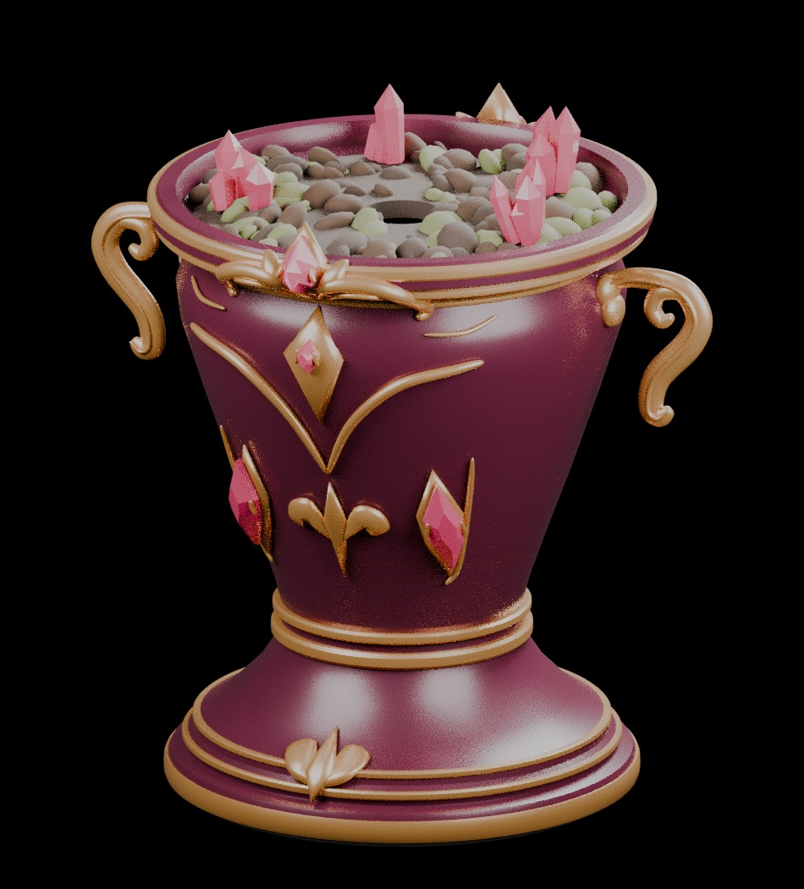

# Blender-model

## v3 — доработанный горшок с исходным лотосом

**[Скачать композицию Blender 5.3](<https://github.com/lisovaarzu/Blender-model/raw/refs/heads/main/Lotus_Original_with_Pot_v3.blend>)**

[Отдельный горшок](<https://github.com/lisovaarzu/Blender-model/raw/refs/heads/main/Fantasy_Pot_v3.blend>) · [Полный отчёт](Report_v3_RU.txt) · [Проверка сохранности цветка](Lotus_Preservation_Check.json)

Все 73 исходных объекта лотоса сохранены: снимки геометрии, трансформаций, материалов, модификаторов и коллекций совпали после повторного открытия файла. Подогнаны только новые части горшка.

**Особенность оригинала:** Leaf_Old, Leaf_Master_02 и Petal_Master скрыты во вьюпорте, но включены для рендера. Белые детали на изображениях композиции присутствуют в исходном файле; их настройки не менялись.

Переработаны сужение чаши, ободок с выемкой, центральная металлическая накладка, оправы и кристаллы, ручки с креплениями, ступенчатое основание. Добавлены грунт и четыре группы растущих кристаллов. 97 600 треугольников горшка, закрытые меши, подготовленные UV. Материалы предварительные, разделены; исходные материалы лотоса не изменялись. Свет и камеры проверки в файлах не сохранены.

Новые коллекции: Pot_Body, Pot_Rim, Pot_Handles, Pot_Gold_Ornaments, Pot_Gems, Pot_Base, Pot_Soil, Pot_Crystals. Подробности материалов и геометрии — в отчёте. Unity отдельно не проверялся.

### Проверочные изображения

[Композиция спереди](v3_previews/Composition_Front.jpg) · [Композиция в перспективе](v3_previews/Composition_Perspective.jpg)

[Горшок спереди](v3_previews/Front.jpg) · [Сбоку](v3_previews/Side.jpg) · [Сверху](v3_previews/Top.jpg) · [Перспектива](v3_previews/Perspective.jpg) · [Крупный план орнамента](v3_previews/Ornament.jpg)

### Предыдущие версии

[v2 — отдельный Blender](<https://github.com/lisovaarzu/Blender-model/raw/refs/heads/main/Fantasy_Vase_v2.blend>) · [v1 — архив](<https://github.com/lisovaarzu/Blender-model/raw/refs/heads/main/Fantasy_Vase_Package.zip>)
